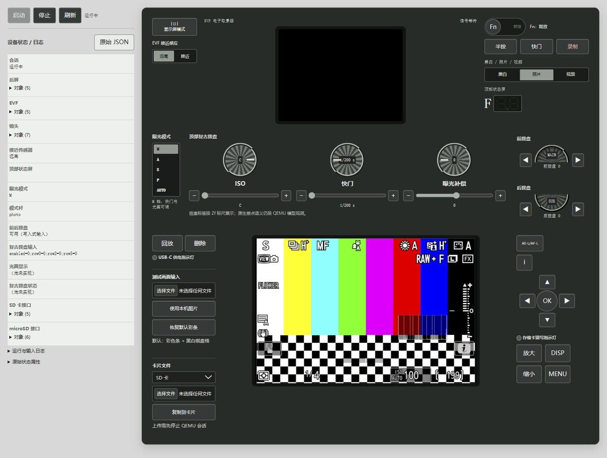

# Nikon Zf QEMU

An experimental Nikon Zf C3.01 machine model, with a command-line launcher and an interactive browser console. Built on official QEMU 10.2.4, with maintained EXPEED 7 device sources derived from WonderLantern's Z9, Z6III and ZR work.

**Source only.** Nikon firmware, EG/EX/LI payloads, flash/NAND dumps, keys, calibration, personal images, runtime logs and private research records are excluded. You provide compatible inputs locally; fixed firmware components are checked by size and SHA256, while local state images are checked only for existence and readability. The launcher never downloads firmware or accesses a physical camera.



WebUI example: the synthetic chart enters the sensor model; the guest renders its own controls and overlays. Runtime logs are collapsed in this screenshot.

## Build

Linux is supported; on Windows, run these commands inside WSL. Install Python 3.10+, a C/C++ toolchain, Git, Ninja, pkg-config, GLib, pixman, libjpeg, x264, x265 and the dependencies required by QEMU 10.2.4. The configure step also needs Meson and QEMU's normal Python/build dependencies.

```sh
git clone https://github.com/WonderLantern/zf-qemu.git
cd zf-qemu
python3 -m venv .venv
. .venv/bin/activate
pip install -r requirements.txt
python3 tools/build.py --jobs 4
```

The build tool obtains official QEMU source only, verifies its pinned revision, installs this repository's maintained model files, and builds both `qemu-system-aarch64` and `qemu-img` in `.cache/build`. For an offline build, provide an existing official checkout with `--source /path/to/qemu`; see [build details](docs/build.md).

## Configure your local inputs

Copy `config.example.json` to a local configuration outside the public source tree. Fill in the executable, input and state paths. Relative paths resolve against the configuration file. Fixed firmware sizes/hashes and local-image requirements are described in [input requirements](docs/inputs.md); `zf_qemu/inputs.json` contains fixed firmware fingerprints only.

```sh
python3 -m zf_qemu verify --config /path/to/local-config.json
```

The four fixed firmware components, including LI, and a local `snor_user` image are required. An initialized local `nand` template is optional. Neither local image is pinned to an individual file's size or SHA256. Firmware mismatches stop startup with an error; the launcher does not patch, decrypt or repair inputs. Fresh, empty FAT32 cards and a synthetic 6048 × 4032 RGGB test frame are generated locally.

## Run

Both modes share exactly the same input checks and VM profile:

```sh
# Command line; Ctrl+C stops the VM. No default session time limit.
python3 -m zf_qemu run --config /path/to/local-config.json

# Optional bounded CLI session
python3 -m zf_qemu run --config /path/to/local-config.json --seconds 120

# Browser console, bound to localhost only
python3 -m zf_qemu web --config /path/to/local-config.json --port 8766
```

Open `http://127.0.0.1:8766/` for the WebUI. It includes LCD/EVF output at 3 FPS, a segment top display, native button/dial inputs, persistent selectors, Fn hold/lock, LED readouts, local SD/microSD uploads, and custom sensor test images. Disabled controls identify unfinished model features. Stop the VM before copying files to a card. Changing sensor images restarts the running VM because the source is loaded at startup.

The shared profile deliberately uses functional sensor/ISP models and synthetic battery/lens behavior. It does not establish physical-camera fidelity, optical quality, full Linux startup or working video recording. Read [verification limits](docs/verification-status.md) before interpreting results.

## Develop and test

Edit the actual sources in `qemu/hw`, `qemu/include`, `qemu/target` and `qemu/configs`. Rebuild with `tools/build.py`; there is no research patch-generator chain. Python launch/UI code lives in `zf_qemu/`.

```sh
git worktree add -b codex/my-change ../zf-qemu-my-change main
python3 tests/run_contracts.py
python3 -m unittest discover -s tests -p 'test_*.py'
python3 tests/check_release_tree.py .
```

Each worktree has its own ignored build cache. Keep configuration, firmware, state and test outputs outside commits. Publish with `git archive`, which excludes untracked inputs and build caches.

## License and acknowledgements

Zf-authored model sources use GPL-2.0-or-later. Upstream and imported components retain their licenses and copyright notices. See [COPYING](COPYING), [QEMU licensing](LICENSES/QEMU-LICENSE.txt) and [NOTICE.md](NOTICE.md).

Thanks to [WonderLantern/z9-qemu](https://github.com/WonderLantern/z9-qemu), [WonderLantern/z63-qemu](https://github.com/WonderLantern/z63-qemu) and [WonderLantern/zr-qemu](https://github.com/WonderLantern/zr-qemu) for their shared EXPEED 7 model work. This project is independent and is not affiliated with or endorsed by Nikon Corporation.

中文运行说明见 [docs/usage.zh-CN.md](docs/usage.zh-CN.md)。
